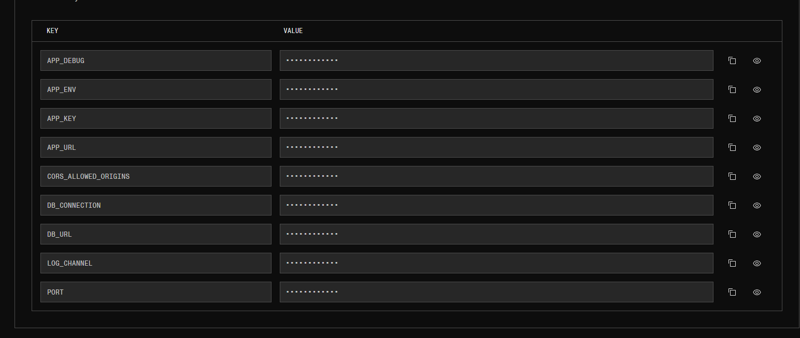
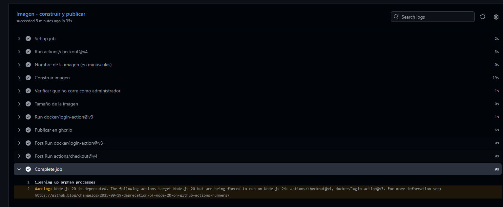
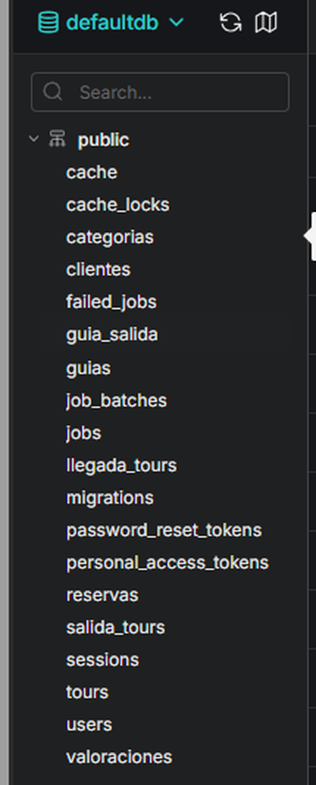
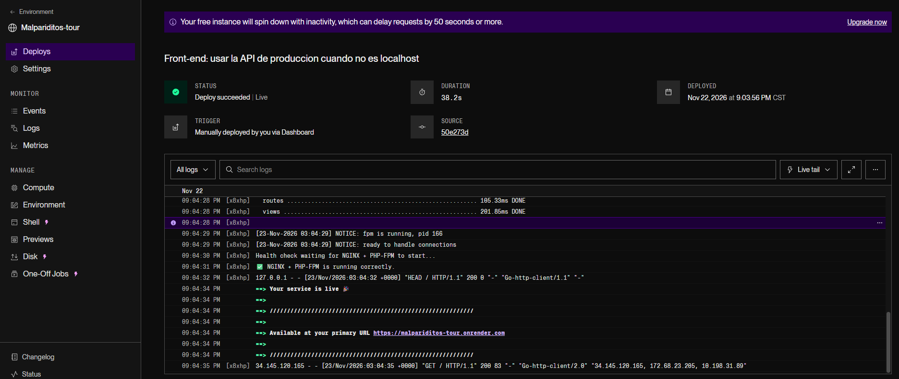
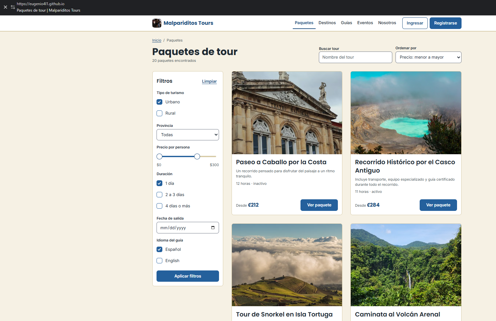
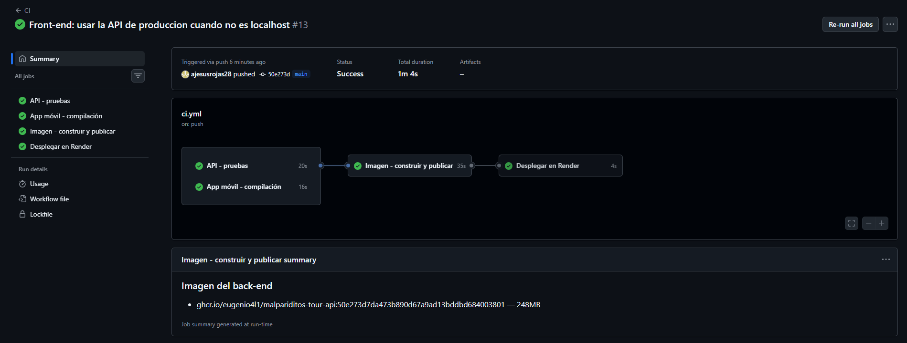
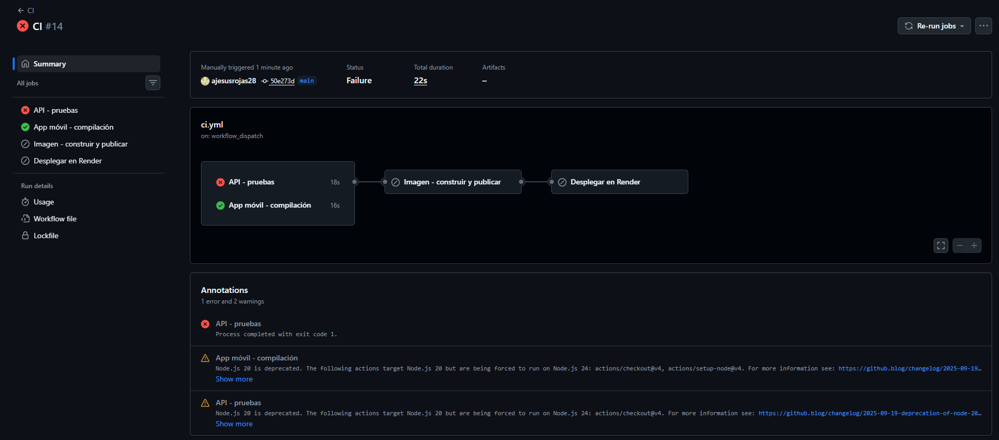
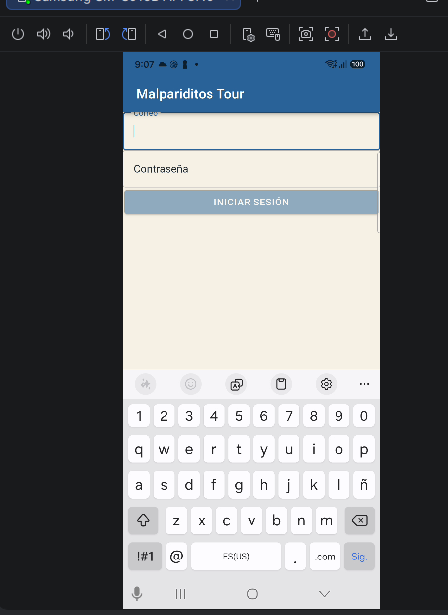
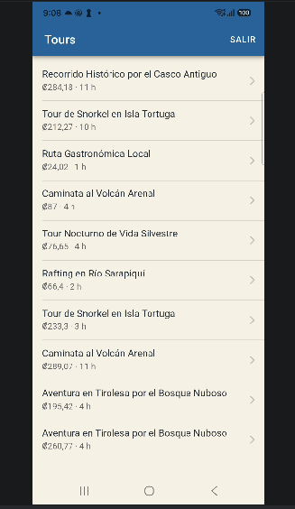
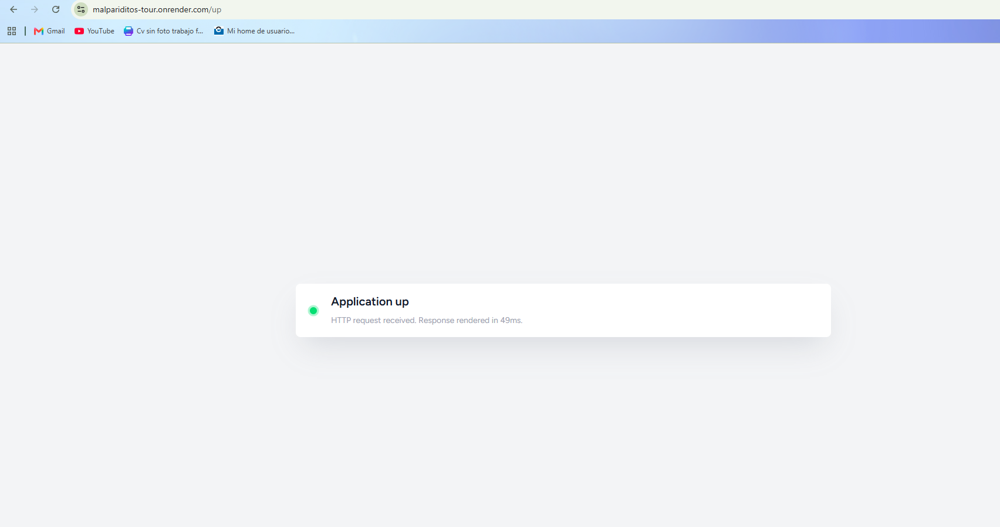

# Laboratorio 14 — Despliegue del proyecto en un entorno operativo

**Proyecto:** Malpariditos Tour  

---

## 1. Direcciones públicas

| Componente | Dirección |
|---|---|
| Aplicación web (front-end) | https://eugenio4l1.github.io/Malpariditos-tour/ |
| API REST (back-end) | https://malpariditos-tour.onrender.com |
| Endpoint de estado | https://malpariditos-tour.onrender.com/up |
| Ejemplo de recurso | https://malpariditos-tour.onrender.com/api/tours |
| Imagen del contenedor | `ghcr.io/eugenio4l1/malpariditos-tour-api` |
| Repositorio | https://github.com/Eugenio4l1/Malpariditos-tour |
| Paquete móvil firmado | `mobile/android/app/release/app-release.apk` (entregado en Mediación Virtual) |

---

## 2. Arquitectura de despliegue

```
 Desarrollador ── push a main ──▶ GitHub ──▶ GitHub Actions (CI/CD)
                                    │            1. pruebas de la API
                                    │            2. compilación de la app móvil
                                    │            3. imagen Docker ──▶ ghcr.io
                                    │            4. Deploy Hook ──▶ Render
                                    │
                                    └─ rama gh-pages ──▶ GitHub Pages (front-end web)

 Navegador web ───── HTTPS ──▶ GitHub Pages ─┐
                                             ├─ HTTPS ──▶ API Laravel (contenedor en Render)
 App Android (APK) ─────────── HTTPS ────────┘                     │
                                                                   └─ SSL ──▶ PostgreSQL (Aiven)
```

| Capa | Tecnología | Dónde corre |
|---|---|---|
| Front-end web | HTML, CSS y JavaScript estático (carpeta `src/`) | GitHub Pages (rama `gh-pages`) |
| App móvil | Ionic Vue + Capacitor 8 (carpeta `mobile/`) | Dispositivo Android (APK firmado) |
| Back-end | Laravel 13, PHP 8.4, Laravel Sanctum | Contenedor Docker en Render (servicio web) |
| Base de datos | PostgreSQL gestionado | Aiven |
| Integración y entrega continuas | GitHub Actions (`.github/workflows/ci.yml`) | GitHub |
| Registro de imágenes | GitHub Container Registry | ghcr.io |

---

## 3. Configuración por entornos

Hay tres ámbitos de configuración y en ninguno se versionan credenciales:

| Entorno | Dónde se define | Notas |
|---|---|---|
| Desarrollo (API) | `backend/.env`, creado a partir de `backend/.env.example` | `.env` está en `.gitignore`; la plantilla no contiene secretos |
| Producción (API) | Variables de entorno en el panel de Render | Los valores no están en el repositorio ni en la imagen |
| App móvil | `mobile/.env` (`VITE_API_URL`), leído al compilar | `.env` ignorado; `mobile/.env.example` es solo plantilla |

Variables que se configuran en producción (solo los nombres; los valores viven en Render):

| Variable | Propósito |
|---|---|
| `APP_ENV` | Entorno de ejecución (`production`) |
| `APP_DEBUG` | Debe ser `false` en producción |
| `APP_KEY` | Llave de cifrado de la aplicación |
| `APP_URL` | URL pública de la API (HTTPS) |
| `CORS_ALLOWED_ORIGINS` | Orígenes autorizados a consumir la API |
| `DB_CONNECTION` | Controlador de base de datos (`pgsql`) |
| `DB_URL` | Cadena de conexión a la base de datos de Aiven |
| `LOG_CHANNEL` | Salida de registros (`stderr`, visible en Render) |
| `PORT` | Puerto del contenedor |



**Falla explícita ante configuración ausente o insegura.** El proveedor `App\Providers\ConfiguracionProduccionProvider` revisa en producción la llave de la aplicación, el modo de depuración, la URL, la base de datos y los orígenes CORS. Si algo falta o es inseguro, la aplicación se niega a arrancar. Esto se comprobó en el despliegue real: con `CORS_ALLOWED_ORIGINS` vacío, Render registró

```
Configuración de producción inválida:
- CORS_ALLOWED_ORIGINS debe listar los orígenes permitidos (ni vacío ni "*").
```

y el contenedor no inició hasta definir la variable.

**Front-end web.** `ApiClient.js` usa `http://localhost:8000/api` cuando se abre en `localhost` y la API de producción en cualquier otro dominio, por lo que no hay direcciones sensibles ni credenciales en el código.

---

## 4. Empaquetado y tamaño de los artefactos

| Artefacto | Tamaño | Cómo se obtiene |
|---|---|---|
| Imagen Docker de la API | **248 MB** | Resumen del job `imagen` del CI (captura 1) |
| Construcción optimizada de la app móvil (`mobile/dist`) | **≈ 1,3 MB** sin comprimir (1 326 kB) | `npm run build` (Vite) |
| Mayor fragmento de la app móvil (`http-*.js`) | 1 146 kB (245 kB comprimido con gzip) | Salida de Vite |
| Resto de los fragmentos | `index-*.js` 56,7 kB; CSS 14,0 kB; el resto, menos de 40 kB cada uno | Salida de Vite |
| Front-end web (`src/`, sin paso de compilación) | ≈ 132 KB | Archivos estáticos publicados tal cual |
| APK firmado | _(completar: tamaño del archivo `app-release.apk`)_ | Propiedades del archivo |

- **Back-end:** se empaqueta para producción en la etapa de construcción del `Dockerfile` con `composer install --no-dev` y `composer dump-autoload --optimize`; el resultado vive dentro de la imagen.
- **App móvil:** Vite advierte que un fragmento supera los 500 kB. Una mejora posible es dividirlo con importaciones dinámicas.

---

## 5. Contenerización

El archivo `backend/Dockerfile` usa **construcción en múltiples etapas**:

1. **Etapa `vendor`** (`composer:2`): instala las dependencias sin paquetes de desarrollo y genera el autoloader optimizado. No llega a la imagen final.
2. **Etapa `final`** (`serversideup/php:8.4-fpm-nginx-alpine`): imagen mínima basada en Alpine con Nginx y PHP-FPM. Solo recibe el resultado de la etapa anterior.

Medidas de seguridad y operación:

- **Usuario sin privilegios:** `USER www-data` (UID 82). El contenedor no se ejecuta como administrador.
- **Verificación automática en el CI:** el paso «Verificar que no corre como administrador» ejecuta `id -u` dentro de la imagen y falla si el resultado es `0` (captura 2).
- **Comprobación de salud:** `HEALTHCHECK` contra `/up` cada 30 segundos.
- **`.dockerignore`:** excluye `.env*`, `vendor`, `tests`, registros, cachés y `bootstrap/cache/*.php`, para que ningún secreto ni caché de desarrollo entre a la imagen.
- **Arranque automático:** con `AUTORUN_ENABLED=true`, al iniciar el contenedor se ejecutan las migraciones y las optimizaciones de Laravel.



---

## 6. Despliegue

### 6.1 Base de datos (Aiven PostgreSQL)

El servicio de PostgreSQL está en ejecución y la API se conecta con la variable `DB_URL` usando SSL. Las migraciones se ejecutaron en el entorno de producción: la tabla `migrations` y las demás tablas del modelo (`tours`, `categorias`, `reservas`, `personal_access_tokens`, entre otras) existen en la base.



### 6.2 Back-end (Render)

La API corre como servicio web de tipo Docker, construido desde el `Dockerfile` de la carpeta `backend/`, con la ruta `/up` como comprobación de salud y HTTPS gestionado por la plataforma. En los registros se ve el arranque de Nginx y PHP-FPM y el mensaje «Your service is live».



### 6.3 Front-end web (GitHub Pages)

La carpeta `src/` se publica en la rama `gh-pages`. El front-end consume la API de producción y muestra el catálogo completo (20 paquetes).



---

## 7. Integración y entrega continuas

El flujo `.github/workflows/ci.yml` se ejecuta con cada `push` a `main` (y también en `pull_request` y de forma manual):

| Job | Qué hace | Condición |
|---|---|---|
| `api` | Instala dependencias de Composer y ejecuta la suite de pruebas (`php artisan test`) | Siempre |
| `movil` | Instala dependencias con `npm ci` y compila la app móvil | Siempre |
| `imagen` | Construye la imagen, verifica que no corre como administrador, publica el tamaño y la sube a ghcr.io | `needs: [api, movil]` y solo en `push` a `main` |
| `desplegar` | Invoca el Deploy Hook de Render (secreto `RENDER_DEPLOY_HOOK_URL`) y consulta `/up` | `needs: [imagen]` y solo en `push` a `main` |

Como `imagen` depende de `api` y `movil`, y `desplegar` depende de `imagen`, **una prueba fallida detiene la cadena y no se despliega nada**.

### Evidencia de una ejecución exitosa

Ejecución #13: los cuatro jobs en verde, con la imagen publicada de 248 MB.



### Evidencia de una ejecución detenida por una prueba fallida

Ejecución #14, lanzada manualmente con la opción `simular_fallo`, que activa la prueba `SimulacroFalloTest`. El job `API - pruebas` falla y los jobs `Imagen` y `Desplegar en Render` quedan omitidos.



---

## 8. Aplicación móvil

- **Tecnología:** Ionic Vue con Capacitor 8; identificador `cr.ac.ucr.malpariditos`.
- **Configuración:** la URL de la API se inyecta al compilar mediante `VITE_API_URL` (`https://malpariditos-tour.onrender.com/api`). La aplicación usa el esquema `https` (origen `https://localhost`), autorizado en `CORS_ALLOWED_ORIGINS`.
- **Compilación:** `npm run sync` genera la versión web y la copia al proyecto Android.
- **Firma:** el paquete se generó en Android Studio con **Build → Generate Signed App Bundle / APK** (tipo APK, variante `release`, firmas V1 y V2). El almacén de llaves (`.jks`) se guarda fuera del repositorio y no se versiona.
- **Resultado:** `mobile/android/app/release/app-release.apk`.

| Inicio de sesión | Lista de tours (datos desde la API) |
|---|---|
|  |  |

> **Pendiente de completar:** salida del comando `apksigner verify --verbose app-release.apk` (debe indicar `Verified using v2 scheme ... true`) y tamaño del archivo.

---

## 9. Verificación del despliegue

| Comprobación | Resultado | Evidencia |
|---|---|---|
| La aplicación responde públicamente | Correcto: la API y el sitio web responden por Internet | Capturas siguientes |
| Endpoint de estado | `/up` responde «Application up» | Captura siguiente |
| Certificado válido | HTTPS gestionado por Render; las respuestas incluyen `strict-transport-security` | _(adjuntar captura del candado del navegador)_ |
| Variables sensibles no expuestas | Valores ocultos en el panel; `APP_DEBUG=false`; los errores de la API usan un formato JSON sin trazas de pila ni rutas del servidor | Captura de variables (sección 3) |



> **Pendiente de completar:** captura que muestre el certificado válido (candado en el navegador) y el resultado de estas dos pruebas:
>
> ```powershell
> curl.exe -i https://malpariditos-tour.onrender.com/.env       # esperado: 404
> curl.exe -i https://malpariditos-tour.onrender.com/api/user   # esperado: 401 en JSON, sin trazas
> ```

---

## 10. Problemas encontrados y soluciones

| Problema | Causa | Solución |
|---|---|---|
| La API no arrancaba: «Class `Laravel\Pail\PailServiceProvider` not found» | `bootstrap/cache/packages.php` estaba versionado y registraba paquetes de desarrollo que la imagen (`--no-dev`) no instala | Excluir `bootstrap/cache/*.php` del repositorio y de la imagen (`.dockerignore`), y conservar la carpeta con un `.gitignore` interno |
| La API se negaba a iniciar | `CORS_ALLOWED_ORIGINS` vacío; la validación de producción lo bloquea a propósito | Definir los orígenes permitidos en Render |
| El CI fallaba en `API - pruebas` | La carpeta `bootstrap/cache` no existía en el clon del repositorio | Agregar `bootstrap/cache/.gitignore` |
| Gradle no sincronizaba el proyecto Android | La versión de Gradle (9.9.1) era incompatible con el plugin de Android (AGP 8.13) | Fijar Gradle 9.5.0 en `gradle-wrapper.properties` |
| La app móvil mostraba «Sin conexión con el servidor» | `mobile/.env` aún apuntaba a `http://10.0.2.2:8000/api`, dirección del emulador | Apuntar `VITE_API_URL` a la API de producción y recompilar |

---

## 11. Cómo reproducir el despliegue

1. Crear el servicio de PostgreSQL en Aiven y copiar su URI de conexión.
2. Crear en Render un servicio web de tipo Docker con la carpeta raíz `backend`, la ruta de salud `/up` y las variables de la sección 3.
3. Guardar el Deploy Hook de Render como secreto `RENDER_DEPLOY_HOOK_URL` en GitHub (Settings → Secrets and variables → Actions).
4. Hacer `push` a `main`: el flujo de CI prueba, construye y despliega.
5. Publicar el front-end: `git subtree split --prefix src main` y enviar el resultado a la rama `gh-pages`.
6. App móvil: definir `VITE_API_URL` en `mobile/.env`, ejecutar `npm run sync` y generar el APK firmado desde Android Studio.
